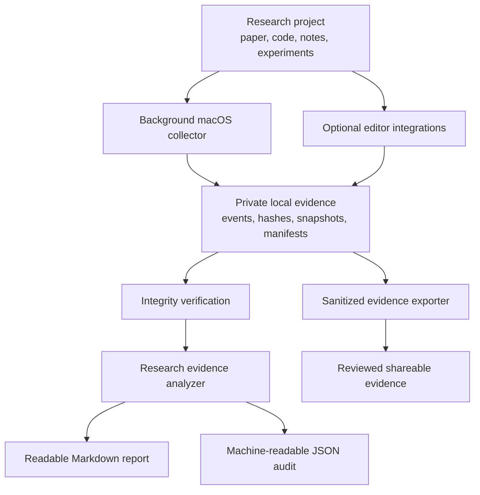

# Research Activity Logger

**A practical, local-first toolkit for recording the evolution of research work and preparing transparent, privacy-conscious evidence of the research process.**

Research is more than the final paper or the final Git commit. Ideas evolve through drafts, code changes, experiments, figures, notes, and revisions. Much of that process is easy to lose track of, especially when work is spread across editors and repositories. Reconstructing it months later can be difficult for the researcher, collaborators, or reviewers.

This project helps create a contemporaneous record of that work with as little manual bookkeeping as possible. It combines background file and Git observation with optional editor integrations, integrity checks, and reports that summarize the evidence in a form that can be reviewed and shared deliberately.

The goal is not only to preserve how research artifacts evolved, but also to support **transparent disclosure of AI use in research**. When AI tools are used, researchers should be able to describe that use honestly and, where possible, support the description with contemporaneous records. This toolkit aims to make relevant activity easier to document rather than relying entirely on recollection after a paper is complete.

The goal is not to judge how someone writes or to replace normal research practice. The goal is to make the development of research artifacts easier to document: what changed, when the system observed it, which supported editor or AI-tool events were recorded, how recorded artifacts relate to Git history, and what evidence can be independently checked.

## What this project helps you do

- **Record research activity automatically.** Observe saved manuscript, source-code, configuration, notes, and experiment-artifact changes while you work.
- **Support AI-use transparency.** Record supported editor events and surface potential AI-content signals as prompts for review and disclosure, not as definitive authorship judgments.
- **Keep a local history of artifact states.** Store hashes, snapshots, event records, and periodic manifests in a project-local evidence directory.
- **Connect activity to version control.** Record observed local Git HEAD changes alongside file activity.
- **Capture supported editor events.** Optionally record supported Cursor events and VS Code buffer-change metadata.
- **Check evidence integrity.** Verify event hash chains and saved-artifact hashes.
- **Prepare reviewer-friendly summaries.** Generate readable Markdown and machine-readable JSON reports without exposing raw working logs by default.
- **Choose what to share.** Keep detailed records private and export a reviewed, sanitized evidence package when needed.

## How it fits together

The normal workflow is designed to run in the background. You work in your paper or code repository; the collector observes supported changes; and, when you need a summary, the analyzer turns the available records into a report.



## Quick start

<details>
<summary><strong>Before you begin</strong></summary>

The automatic background collector currently targets **macOS**. You will need:

- macOS with Python 3 available as `python3`.
- Git installed.
- A local Git working tree for the paper, code, or other research project you want to monitor.
- Permission to install a user-level LaunchAgent under `~/Library/LaunchAgents/`.

The toolkit repository and the research project are separate: clone this repository once, then install its collector into each research repository you want to monitor.

</details>

### 1. Clone this toolkit

Open Terminal and run:

```bash
git clone https://github.com/prateekiiest/research-activity-logger.git ~/research-activity-logger
cd ~/research-activity-logger
```

### 2. One-command setup (recommended)

On macOS, with Python 3, Git, Node.js/npm, and VS Code installed, run this once for each research Git repository:

```bash
bash ~/research-activity-logger/scripts/setup_research_provenance.sh ~/work/my-paper
```

The installer packages and installs the VS Code extension, installs the background macOS collector, adds the private evidence directory to `.gitignore`, and installs Cursor hooks only if doing so will not overwrite an existing Cursor hook configuration. It does not overwrite your existing project files other than the intended `.gitignore` addition and supplied runtime scripts. The VS Code `code` command must be available on your PATH; if it is not, use VS Code's `Shell Command: Install 'code' command in PATH` command and rerun the installer.

Then open the research project in VS Code and run **Writing Provenance: Initialize This Research Workspace** from the Command Palette. Confirm the consent prompt to enable editor metadata capture. This is the one-time workspace opt-in; tracking remains disabled until you explicitly confirm.

The installer requires internet access once to package the extension through npm. The extension itself makes no network requests and does not upload logs.

### 3. GitHub Actions setup in each research repository

The one-command installer also installs a project-level GitHub Actions workflow at:

```text
.github/workflows/research-provenance.yml
```

It installs this workflow only when that path does not already exist. If you already have a workflow with that name, it is preserved; review the template at [templates/research-project-provenance.yml](templates/research-project-provenance.yml) and merge the relevant checks manually.

After installation, commit and push the workflow and the supplied project scripts from your research repository:

```bash
git status
git add .github/workflows scripts .gitignore
git commit -m "Set up research provenance tracking"
git push
```

Then open the research repository on GitHub and select **Actions** to inspect the `Research provenance` workflow run. It runs on pushes, pull requests, and manual dispatch. You can also start it manually from the workflow page.

The workflow checks that the installed Python scripts compile and expose their command-line help, guards against accidentally tracking private `.writing-provenance/` records, and validates supported sanitized JSON evidence files when present.

**Important scope limitation:** GitHub-hosted runners cannot access your Mac's local VS Code buffers, LaunchAgent, or ignored `.writing-provenance/` event logs. The workflow validates repository tooling and committed/sanitized artifacts; it does not verify local activity, establish that collection was continuously running, or prove that AI was or was not used.


Run the installer once for each separate Git working tree you want to monitor. If your paper and code are in the same Git repository, install only once. It replaces the toolkit's named runtime scripts in the target `scripts/` directory; keep local modifications to those same-named files elsewhere before running it. If the project already has `.cursor/hooks.json`, it is left untouched and must be merged manually; see [Editor integrations](#editor-integrations).

### 3. Confirm that the collector is running

From the root of your research project:

```bash
launchctl list | grep research-activity-logger
```

The LaunchAgent starts immediately, starts again at login, and is configured to restart after an unexpected exit. To inspect its error log:

```bash
tail -f .writing-provenance/launchd/stderr.log
```

### 4. Work normally

Edit and save your manuscript, code, notes, or experiment files as usual. The collector runs in the background; you do not need to keep a terminal process open or write a diary entry for every edit.

The private records are stored in:

```text
.writing-provenance/
```

This directory is added to `.gitignore` by the installer. Keep it private; it contains the detailed local evidence records and snapshots.

### 5. Verify the recorded evidence

From the root of the monitored research project:

```bash
python3 scripts/verify_macos_provenance.py --snapshots
```

This checks the available event-chain records and saved snapshot hashes.

### 6. Generate a research evidence report

Run:

```bash
python3 scripts/analyze_research_evidence.py
```

The analyzer creates:

```text
public-evidence/
├── research-evidence-report.md
└── research-evidence-audit.json
```

The Markdown file is intended to be readable by a collaborator or reviewer. The JSON file provides a structured audit summary. The default analysis is local and offline.

### 7. Review before sharing

Open both generated files and check that the contents are appropriate for your intended audience. The report is designed to summarize evidence without publishing raw event logs, snapshots, prompts, responses, document contents, absolute paths, or usernames.

You can also generate a sanitized artifact manifest:

```bash
python3 scripts/export_public_evidence.py
```

Review every generated file before adding it to a paper appendix, project page, or submission package. Do not publish `.writing-provenance/` or raw snapshots.

The exporter also creates a path-redacted reviewer package at `public-evidence/reviewer-package/`, containing periodic manifests and matching OpenTimestamps proof files when available. Install the timestamp client before collection to request external anchors:

```bash
python3 -m pip install --user opentimestamps-client
```

The collector requests a timestamp for each six-hour manifest when the `ots` command is available. Requests may remain pending; a proof file is not a verified timestamp until a reviewer successfully verifies it. After collection, export and verify the package:

```bash
python3 scripts/export_public_evidence.py
python3 scripts/verify_reviewer_package.py public-evidence/reviewer-package
python3 scripts/verify_reviewer_package.py public-evidence/reviewer-package --verify-timestamps
```

The first verifier command checks manifest integrity and chain links offline. Timestamp verification may require network access or locally available Bitcoin header data. The installer also copies the reviewer guide to `docs/provenance/REVIEWER_GUIDE.md` and the manifest schema to `schemas/reviewer-manifest-v2.schema.json`. See the [reviewer guide](docs/reviewer-guide.md) and [evidence schema](docs/evidence-schema.md).

## Cold Turkey: read-only storage diagnostic

To identify whether the installed macOS version exposes a locally readable statistics database, run:

```bash
python3 scripts/diagnose_cold_turkey.py
```

The diagnostic prints only candidate-file metadata and SQLite table/column names. It never reads or prints activity rows, URLs, website/application names, or window titles, and it does not modify or upload anything. See [the diagnostic guide](docs/cold-turkey-diagnostic.md). Automatic 15-minute statistics extraction will be implemented only after the actual local schema is identified and validated.

## Automatic Cold Turkey daily aggregates

The macOS collector can read Cold Turkey's local SQLite statistics databases in read-only mode and refresh sanitized daily aggregates every 15 minutes. It exports daily summed seconds and blocked-row counts only; domain, application/file, title, and user identifiers are not selected. The reviewer package can include the sanitized aggregate JSON. See [the reviewer guide](docs/reviewer-guide.md).

## LaunchAgent health and Cold Turkey (optional)

The macOS collector records its own startup, periodic (approximately 60-second) heartbeat after a successful scan, and caught errors. These records help identify collection gaps; they do not independently monitor `launchd` or prove uninterrupted operation. The periodic sanitized manifest can also include hashes and sizes of LaunchAgent stdout/stderr logs.

If Cold Turkey Blocker Statistics is enabled, export the visible statistics from its Statistics tab. To include an integrity reference to that export in a future manifest, keep a private copy at `.writing-provenance/cold-turkey-statistics-export.json`. The collector records only its SHA-256 and size; it does not parse or publish the export. Do not commit or upload the original export: it may contain website, application, or window-title details. A hash proves only which bytes were referenced, not that blocking was continuously enforced. See the [Cold Turkey user guide](https://getcoldturkey.com/support/user-guide/) for the export workflow.

## What gets recorded

The macOS collector periodically observes saved files in the research project, records file hashes and metadata, observes local Git HEAD changes, and creates periodic manifests. It supports common research artifacts such as manuscripts, source files, notes, configuration files, experiment logs, PDFs, and figures.

The evidence analyzer checks available event chains and snapshot hashes, summarizes recorded activity, and reports supported editor events. Its deterministic audit runs locally. The optional AI review described below is a separate, explicit step.

For more detail about installation, captured activity, Overleaf synchronization, external timestamping, and service management, see the [macOS automatic provenance guide](docs/macos-automatic-provenance.md).

## AI-use transparency: what we are trying to establish

A core motivation for this project is to help researchers answer an increasingly important question: **Was AI used during the research or writing process, and if so, how?**

We want to make it easier to document relevant AI-assisted activity while research is happening, rather than treating AI-use disclosure as an afterthought. Depending on the tools and integrations enabled, the evidence may include supported editor or agent events, timestamps, artifact changes, version-control history, and signals from optional AI-content analysis. These records can help a researcher reconstruct and explain their workflow and prepare a more informed disclosure for collaborators, reviewers, or an institution.

The intended outcome is transparency, not a simplistic AI-versus-human verdict. AI use can take many forms, from brainstorming and code assistance to editing, summarization, or generating text. A useful disclosure should describe the nature and extent of assistance where known, rather than rely on a detector score alone.

**Important:** this toolkit cannot guarantee detection of every AI interaction, identify every AI-generated passage, or prove that AI was not used. Integrations observe only the events exposed to them and configured by the user; content detectors are probabilistic and can be wrong. Absence of a recorded event is not proof of absence of AI use. Researchers remain responsible for accurately disclosing their use of AI tools and for following the relevant venue or institutional policies.

## Editor integrations

### Cursor

The installer enables the supplied Cursor hooks when it can safely create a new hook configuration. These hooks record supported Cursor Agent/Tab events as metadata and hashes rather than storing raw prompt, response, or edit text.

If your project already has `.cursor/hooks.json`, the installer will not overwrite it. Review the hook definitions in this repository's `.cursor/hooks.json` and merge the relevant entries into your existing configuration. Then enable the local hook recorder:

```bash
python3 .cursor/hooks/record_provenance.py --enable
```

To disable it:

```bash
python3 .cursor/hooks/record_provenance.py --disable
```

### VS Code

An optional VS Code extension records hashes and metadata for supported unsaved-buffer changes. See the [VS Code/Cursor integration guide](vscode-provenance/README.md) for installation and workspace opt-in instructions.

### Overleaf

If you use Overleaf Git integration, synchronize the project into the local Git working tree monitored by the collector. The collector observes the resulting local saved files and Git HEAD. If Overleaf uses a separate local clone, install the collector in that clone as well. Synchronization remains under your control; the collector does not need or store Overleaf credentials.

## Optional: independent timestamping

For an additional external timestamp on periodic manifests, install the OpenTimestamps client:

```bash
python3 -m pip install --user opentimestamps-client
```

When `ots` is available, the collector can request timestamps for generated manifests. Calendar confirmation may be pending initially. Preserve the manifest JSON and its matching `.ots` proof outside the machine as well. To upgrade and verify a pending proof:

```bash
ots upgrade path/to/manifest.json.ots
ots verify path/to/manifest.json.ots
```

See the [macOS guide](docs/macos-automatic-provenance.md#external-timestamping) for the complete workflow.

## Optional: AI-assisted interpretation of the audit

The evidence analyzer can optionally request a second opinion on the aggregate audit summary:

```bash
export OPENAI_API_KEY="your-api-key"
python3 scripts/analyze_research_evidence.py --ai-review
```

You can optionally select a model using `OPENAI_MODEL` or the analyzer's `--model` option. This is opt-in; the default analyzer makes no network request. The AI reviewer receives aggregate counts, event categories, integrity status, and qualified audit conclusions, not raw logs, file paths, prompts, responses, document contents, or snapshots. Review the provider's data-handling terms before enabling it. The model-generated interpretation is supplementary; the deterministic audit remains the source for computed counts and integrity checks.

See [the evidence report guide](docs/research-evidence-report.md).

## Optional: AI-content triage in GitHub Actions

This repository also includes a separate, non-blocking AI-content triage workflow. It runs complementary checks on changed prose in pushes and pull requests, and can be started manually through GitHub Actions. The checks are intended as review aids, not authorship judgments.

The suite includes descriptive stylometric features, optional open text-classification models, and rules for explicit attribution markers. Some integrations require opt-in configuration, model access, or credentials. See the [AI detector suite guide](docs/ai-detector-suite.md) for setup, model terms, workflow behavior, and reporting details.

## Common tasks

| Task | Command |
|---|---|
| Check that the background service is installed | `launchctl list \| grep research-activity-logger` |
| Inspect collector errors | `tail -f .writing-provenance/launchd/stderr.log` |
| Verify event chains and snapshots | `python3 scripts/verify_macos_provenance.py --snapshots` |
| Generate the reviewer-facing report | `python3 scripts/analyze_research_evidence.py` |
| Generate sanitized artifact evidence | `python3 scripts/export_public_evidence.py` |
| Disable Cursor hook recording | `python3 .cursor/hooks/record_provenance.py --disable` |
| Uninstall the background service | `python3 scripts/install_macos_provenance.py --uninstall --root /absolute/path/to/project` |

Uninstalling the LaunchAgent does not delete the evidence already stored in `.writing-provenance/`.

## Documentation

- [macOS automatic provenance: installation and operations](docs/macos-automatic-provenance.md)
- [Research evidence report: outputs and interpretation](docs/research-evidence-report.md)
- [VS Code/Cursor integration](vscode-provenance/README.md)
- [AI detector suite](docs/ai-detector-suite.md)

## Repository structure

```text
.github/workflows/       GitHub Actions workflows
.cursor/                 Cursor hook definitions and recorder
scripts/                 Collectors, installers, verifiers, exporters, analyzers
docs/                    Setup and usage guides
vscode-provenance/       Optional VS Code extension
```

## AI-use disclosure for this repository

**AI assistance was used in developing this project.** The code for the setup and automation workflows, GitHub Actions configuration, scripts, and VS Code integration was developed with AI assistance. AI tools contributed to code generation and implementation; the resulting code and documentation should therefore not be represented as entirely unaided human-written work. The project maintainer remains responsible for reviewing, testing, maintaining, and accurately describing the behavior and limitations of the software.

This disclosure concerns the development of the toolkit itself. It is separate from any AI-use disclosure that a researcher may need to make about the research conducted in a repository monitored by this toolkit.

## Privacy, scope, and limitations

This project is designed to support transparent research-process documentation. It records what the installed instrumentation can observe; it is not a substitute for sound research practice, reproducible experiments, or clear disclosure.

- The collector observes saved-file states and periodic scans; it does not record every keystroke or reconstruct unsaved work.
- Polling can miss intermediate changes that occur and revert between scans.
- Cursor and VS Code integrations cover only the supported events exposed to their integrations. They do not provide universal AI-use detection.
- Overleaf activity is observed after synchronization into a monitored local working tree.
- The collector does not record browser history, clipboard contents, screenshots, private thoughts, arbitrary terminal commands, or the full runtime state of every experiment.
- Local records can be stopped, deleted, or modified by someone with control of the machine. Hash-chain verification checks the consistency of available records, not their completeness or resistance to a determined administrator.
- Missing events are not evidence that an activity did not occur. A report must not be presented as proof of human authorship or proof that AI was never used.
- AI-content detectors can produce false positives and false negatives. Do not use their scores as the sole basis for academic-integrity, employment, or disciplinary decisions.
- Optional third-party model integrations process the inputs described in their respective guides. Review licenses, access conditions, and data-handling terms before enabling them.

The most defensible use of this toolkit is as one component of a broader record: preserve relevant Git history, experiment configurations and logs, research notes, and selected externally timestamped evidence where appropriate. Describe exactly what was recorded and how it was verified.

## License

See [LICENSE](LICENSE).
