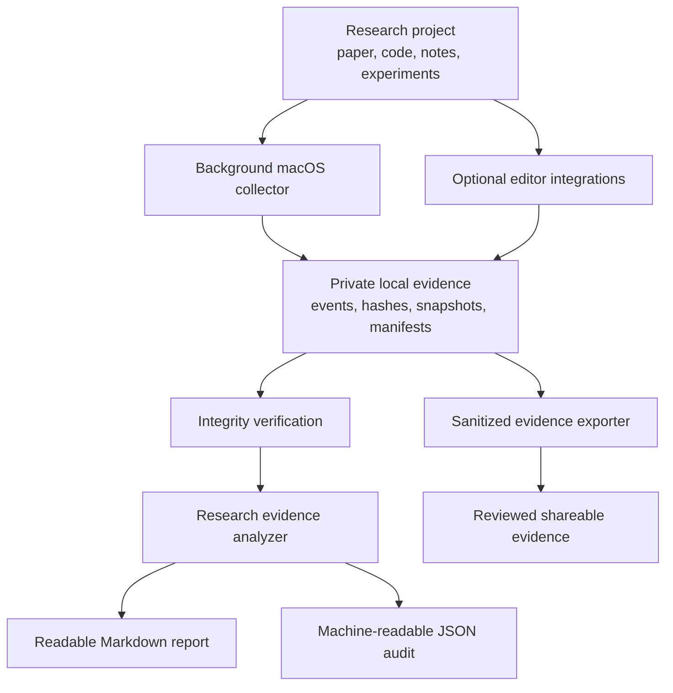

# Research Activity Logger

**A practical, local-first toolkit for recording the evolution of research work and preparing transparent, privacy-conscious evidence of the research process.**

Research is more than the final paper or the final Git commit. Ideas evolve through drafts, code changes, experiments, figures, notes, and revisions. Much of that process is easy to lose track of, especially when work is spread across editors and repositories. Reconstructing it months later can be difficult for the researcher, collaborators, or reviewers.

This project helps create a contemporaneous record of that work with as little manual bookkeeping as possible. It combines background file and Git observation with optional editor integrations, integrity checks, and reports that summarize the evidence in a form that can be reviewed and shared deliberately.

The goal is **not** to judge how someone writes or to replace normal research practice. The goal is to make the development of research artifacts easier to document: what changed, when the system observed it, how recorded artifacts relate to Git history, and what evidence can be independently checked.

## What this project helps you do

- **Record research activity automatically.** Observe saved manuscript, source-code, configuration, notes, and experiment-artifact changes while you work.
- **Keep a local history of artifact states.** Store hashes, snapshots, event records, and periodic manifests in a project-local evidence directory.
- **Connect activity to version control.** Record observed local Git HEAD changes alongside file activity.
- **Capture supported editor events.** Optionally record supported Cursor events and VS Code buffer-change metadata.
- **Check evidence integrity.** Verify event hash chains and saved-artifact hashes.
- **Prepare reviewer-friendly summaries.** Generate readable Markdown and machine-readable JSON reports without exposing raw working logs by default.
- **Choose what to share.** Keep detailed records private and export a reviewed, sanitized evidence package when needed.

## How it fits together

The normal workflow is designed to run in the background. You work in your paper or code repository; the collector observes supported changes; and, when you need a summary, the analyzer turns the available records into a report.



## Quick start

<details>
<summary><strong>Before you begin</strong></summary>

The automatic background collector currently targets **macOS**. You will need:

- macOS with Python 3 available as `python3`.
- Git installed.
- A local Git working tree for the paper, code, or other research project you want to monitor.
- Permission to install a user-level LaunchAgent under `~/Library/LaunchAgents/`.

The toolkit repository and the research project are separate: clone this repository once, then install its collector into each research repository you want to monitor.

</details>

### 1. Clone this toolkit

Open Terminal and run:

```bash
git clone -b research-evidence-report https://github.com/prateekiiest/research-activity-logger.git ~/research-activity-logger
cd ~/research-activity-logger
```

### 2. Install it into your research project

Pass the absolute path to a local Git repository containing your paper or code:

```bash
bash ~/research-activity-logger/scripts/install_into_project.sh /absolute/path/to/your/research-repository
```

For example, if your project is at `~/work/my-paper`:

```bash
bash ~/research-activity-logger/scripts/install_into_project.sh ~/work/my-paper
```

Run the installer once for each separate Git working tree you want to monitor. If your paper and code are in the same Git repository, install only once.

The installer copies the runtime scripts into the project, adds `.writing-provenance/` to that project's `.gitignore`, and installs a project-specific background LaunchAgent. It also installs and enables the Cursor hooks when it can do so without overwriting an existing `.cursor/hooks.json`. If that file already exists, the installer leaves it untouched; see [Editor integrations](#editor-integrations).

### 3. Confirm that the collector is running

From the root of your research project:

```bash
launchctl list | grep research-activity-logger
```

The LaunchAgent starts immediately, starts again at login, and is configured to restart after an unexpected exit. To inspect its error log:

```bash
tail -f .writing-provenance/launchd/stderr.log
```

### 4. Work normally

Edit and save your manuscript, code, notes, or experiment files as usual. The collector runs in the background; you do not need to keep a terminal process open or write a diary entry for every edit.

The private records are stored in:

```text
.writing-provenance/
```

This directory is added to `.gitignore` by the installer. Keep it private; it contains the detailed local evidence records and snapshots.

### 5. Verify the recorded evidence

From the root of the monitored research project:

```bash
python3 scripts/verify_macos_provenance.py --snapshots
```

This checks the available event-chain records and saved snapshot hashes.

### 6. Generate a research evidence report

Run:

```bash
python3 scripts/analyze_research_evidence.py
```

The analyzer creates:

```text
public-evidence/
├── research-evidence-report.md
└── research-evidence-audit.json
```

The Markdown file is intended to be readable by a collaborator or reviewer. The JSON file provides a structured audit summary. The default analysis is local and offline.

### 7. Review before sharing

Open both generated files and check that the contents are appropriate for your intended audience. The report is designed to summarize evidence without publishing raw event logs, snapshots, prompts, responses, document contents, absolute paths, or usernames.

You can also generate a sanitized artifact manifest:

```bash
python3 scripts/export_public_evidence.py
```

Review every generated file before adding it to a paper appendix, project page, or submission package. Do not publish `.writing-provenance/` or raw snapshots.

## What gets recorded

The macOS collector periodically observes saved files in the research project, records file hashes and metadata, observes local Git HEAD changes, and creates periodic manifests. It supports common research artifacts such as manuscripts, source files, notes, configuration files, experiment logs, PDFs, and figures.

The evidence analyzer checks available event chains and snapshot hashes, summarizes recorded activity, and reports supported editor events. Its deterministic audit runs locally. The optional AI review described below is a separate, explicit step.

For more detail about installation, captured activity, Overleaf synchronization, external timestamping, and service management, see the [macOS automatic provenance guide](docs/macos-automatic-provenance.md).

## Editor integrations

### Cursor

The installer enables the supplied Cursor hooks when it can safely create a new hook configuration. These hooks record supported Cursor Agent/Tab events as metadata and hashes rather than storing raw prompt, response, or edit text.

If your project already has `.cursor/hooks.json`, the installer will not overwrite it. Review the hook definitions in this repository's `.cursor/hooks.json` and merge the relevant entries into your existing configuration. Then enable the local hook recorder:

```bash
python3 .cursor/hooks/record_provenance.py --enable
```

To disable it:

```bash
python3 .cursor/hooks/record_provenance.py --disable
```

### VS Code

An optional VS Code extension records hashes and metadata for supported unsaved-buffer changes. See the [VS Code/Cursor integration guide](vscode-provenance/README.md) for installation and workspace opt-in instructions.

### Overleaf

If you use Overleaf Git integration, synchronize the project into the local Git working tree monitored by the collector. The collector observes the resulting local saved files and Git HEAD. If Overleaf uses a separate local clone, install the collector in that clone as well. Synchronization remains under your control; the collector does not need or store Overleaf credentials.

## Optional: independent timestamping

For an additional external timestamp on periodic manifests, install the OpenTimestamps client:

```bash
python3 -m pip install --user opentimestamps-client
```

When `ots` is available, the collector can request timestamps for generated manifests. Calendar confirmation may be pending initially. Preserve the manifest JSON and its matching `.ots` proof outside the machine as well. To upgrade and verify a pending proof:

```bash
ots upgrade path/to/manifest.json.ots
ots verify path/to/manifest.json.ots
```

See the [macOS guide](docs/macos-automatic-provenance.md#external-timestamping) for the complete workflow.

## Optional: AI-assisted interpretation of the audit

The evidence analyzer can optionally request a second opinion on the aggregate audit summary:

```bash
export OPENAI_API_KEY="your-api-key"
python3 scripts/analyze_research_evidence.py --ai-review
```

You can optionally select a model using `OPENAI_MODEL` or the analyzer's `--model` option. This is opt-in; the default analyzer makes no network request. The AI reviewer receives aggregate counts, event categories, integrity status, and qualified audit conclusions, not raw logs, file paths, prompts, responses, document contents, or snapshots. Review the provider's data-handling terms before enabling it. The model-generated interpretation is supplementary; the deterministic audit remains the source for computed counts and integrity checks.

See [the evidence report guide](docs/research-evidence-report.md).

## Optional: AI-content triage in GitHub Actions

This repository also includes a separate, non-blocking AI-content triage workflow. It runs complementary checks on changed prose in pushes and pull requests, and can be started manually through GitHub Actions. The checks are intended as review aids, not authorship judgments.

The suite includes descriptive stylometric features, optional open text-classification models, and rules for explicit attribution markers. Some integrations require opt-in configuration, model access, or credentials. See the [AI detector suite guide](docs/ai-detector-suite.md) for setup, model terms, workflow behavior, and reporting details.

## Common tasks

| Task | Command |
|---|---|
| Check that the background service is installed | `launchctl list \| grep research-activity-logger` |
| Inspect collector errors | `tail -f .writing-provenance/launchd/stderr.log` |
| Verify event chains and snapshots | `python3 scripts/verify_macos_provenance.py --snapshots` |
| Generate the reviewer-facing report | `python3 scripts/analyze_research_evidence.py` |
| Generate sanitized artifact evidence | `python3 scripts/export_public_evidence.py` |
| Disable Cursor hook recording | `python3 .cursor/hooks/record_provenance.py --disable` |
| Uninstall the background service | `python3 scripts/install_macos_provenance.py --uninstall --root /absolute/path/to/project` |

Uninstalling the LaunchAgent does not delete the evidence already stored in `.writing-provenance/`.

## Documentation

- [macOS automatic provenance: installation and operations](docs/macos-automatic-provenance.md)
- [Research evidence report: outputs and interpretation](docs/research-evidence-report.md)
- [VS Code/Cursor integration](vscode-provenance/README.md)
- [AI detector suite](docs/ai-detector-suite.md)

## Repository structure

```text
.github/workflows/       GitHub Actions workflows
.cursor/                 Cursor hook definitions and recorder
scripts/                 Collectors, installers, verifiers, exporters, analyzers
docs/                    Setup and usage guides
vscode-provenance/       Optional VS Code extension
```

## Privacy, scope, and limitations

This project is designed to support transparent research-process documentation. It records what the installed instrumentation can observe; it is not a substitute for sound research practice, reproducible experiments, or clear disclosure.

- The collector observes saved-file states and periodic scans; it does not record every keystroke or reconstruct unsaved work.
- Polling can miss intermediate changes that occur and revert between scans.
- Cursor and VS Code integrations cover only the supported events exposed to their integrations. They do not provide universal AI-use detection.
- Overleaf activity is observed after synchronization into a monitored local working tree.
- The collector does not record browser history, clipboard contents, screenshots, private thoughts, arbitrary terminal commands, or the full runtime state of every experiment.
- Local records can be stopped, deleted, or modified by someone with control of the machine. Hash-chain verification checks the consistency of available records, not their completeness or resistance to a determined administrator.
- Missing events are not evidence that an activity did not occur. A report must not be presented as proof of human authorship or proof that AI was never used.
- AI-content detectors can produce false positives and false negatives. Do not use their scores as the sole basis for academic-integrity, employment, or disciplinary decisions.
- Optional third-party model integrations process the inputs described in their respective guides. Review licenses, access conditions, and data-handling terms before enabling them.

The most defensible use of this toolkit is as one component of a broader record: preserve relevant Git history, experiment configurations and logs, research notes, and selected externally timestamped evidence where appropriate. Describe exactly what was recorded and how it was verified.

## License

See [LICENSE](LICENSE).
